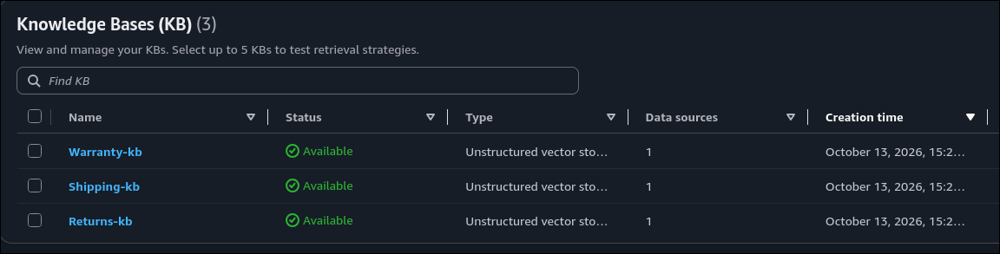
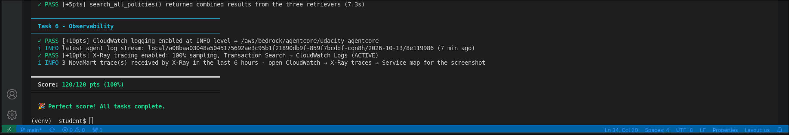
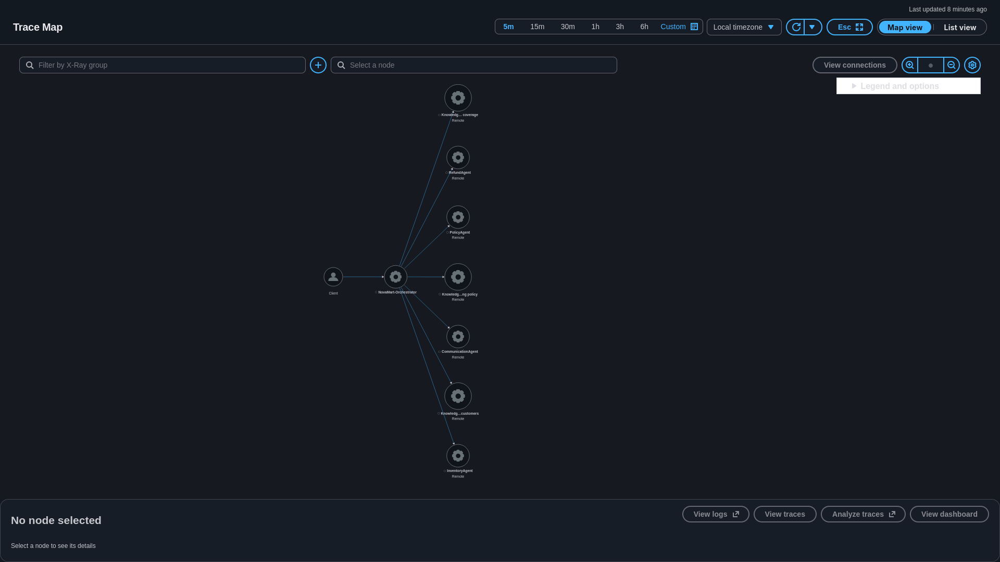
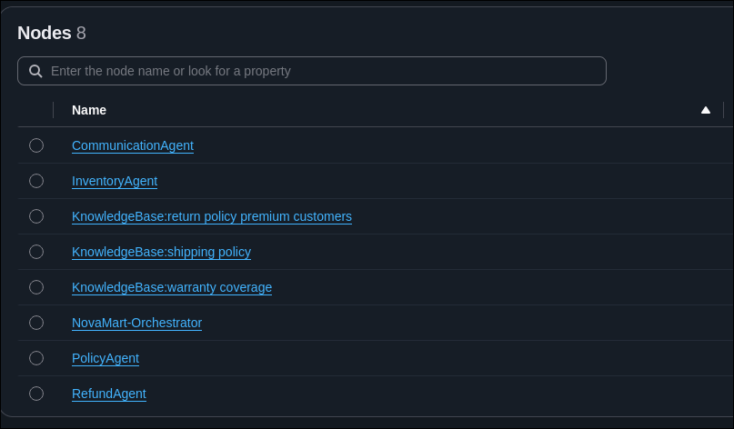

# NovaMart AI Customer Support Agent

A multi-agent AI customer support system built with **Amazon Bedrock AgentCore** and the **Strands Agents SDK**. It automates customer support workflows by routing requests to specialized agents for order inquiries, refund eligibility, and policy questions.

## Architecture

The system follows an **Orchestrator → Workers** architecture with five specialized agents:

- **Orchestrator Agent** — Understands customer intent and routes requests to the appropriate specialist.
- **Inventory Agent** — Retrieves order and customer information from DynamoDB.
- **Policy Agent** — Answers policy questions using parallel RAG across three Amazon Bedrock Knowledge Bases.
- **Refund Agent** — Evaluates return and refund eligibility based on order data and company policies.
- **Communication Agent** — Generates professional, customer-facing responses.

## Key Features

- Intelligent request routing and multi-agent coordination.
- Parallel retrieval-augmented generation (RAG).
- Automated refund eligibility decisions.
- Bedrock Guardrails for AI safety and responsible responses.
- Session memory for multi-turn conversations.
- CloudWatch logging and AWS X-Ray distributed tracing.

## Project Structure

```text
.
├── code/
│   └── agent_orchestrator.py
├── Knowledge_Bases/
│   └── KB.png
├── Tests/
│   └── Tests.png
├── X_Ray_Service_Map/
│   └── Service_Map.png
│   └── Service_Map_Nodes.png
│   └── Service_Map_Update.png
├── .env.example
└── README.md
```

## AWS Services

- Amazon Bedrock
- Amazon Bedrock AgentCore Runtime
- Amazon Bedrock Knowledge Bases
- Amazon Bedrock Guardrails
- Amazon DynamoDB
- Amazon CloudWatch
- AWS X-Ray

## Project Evidence

### Knowledge Bases



### Tests



### AWS X-Ray Service Map



